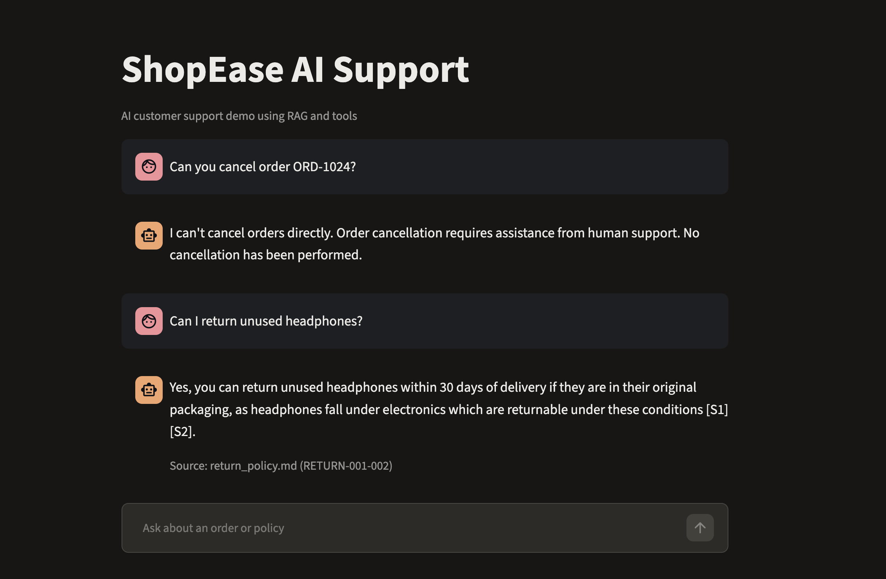
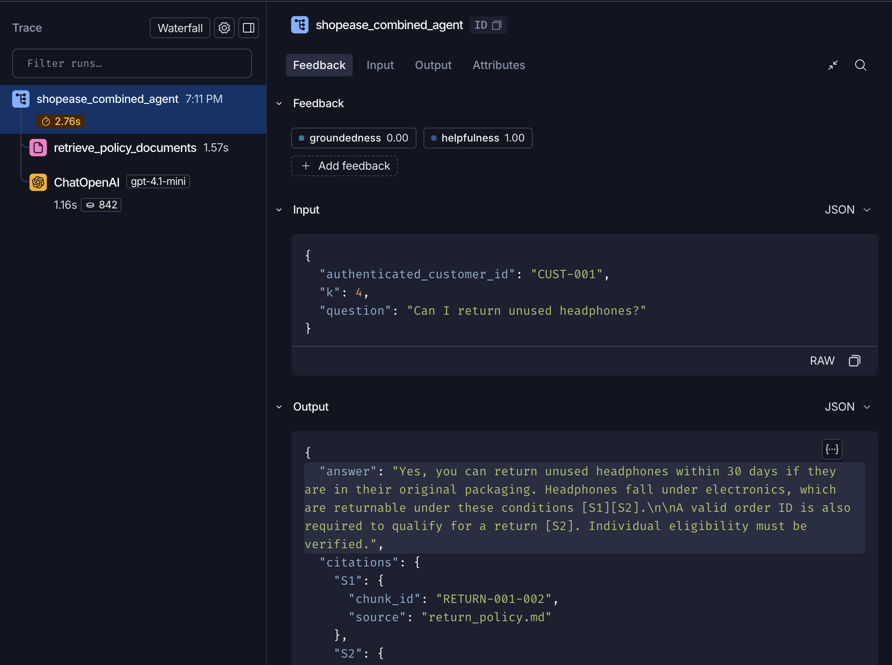
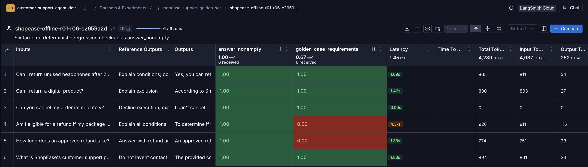
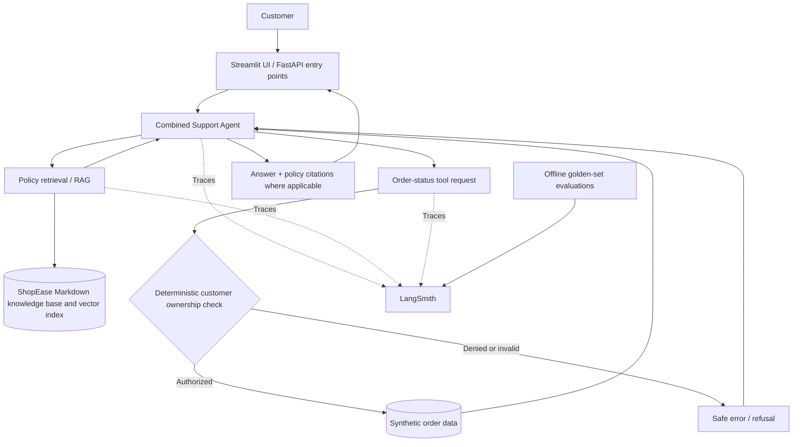

# Customer Support AI Agent

A hands-on AI project that demonstrates how to build, test, and observe a **customer support agent** using **retrieval-augmented generation (RAG)** and **permission-checked tools**.

The agent answers questions about ShopEase policies using a local knowledge base, provides source references, and looks up order status from **synthetic data** only after checking customer ownership. It includes a FastAPI entry point, a Streamlit interface, pytest tests, and LangSmith tracing and evaluations.

> **Project status:** Local learning prototype, stored in a private GitHub repository. **Not publicly deployed or production-ready.**

## What it can do


| Capability | Implementation |
| --- | --- |
| Answer policy questions | Retrieve relevant passages from shipping, return, refund, and contact-support documents, then generate a grounded answer |
| Provide citations | Associate policy claims with retrieved document references |
| Check order status | Call a mock order-lookup tool |
| Restrict order access | Use deterministic customer-to-order ownership checks before returning order details |
| Handle restricted actions | Decline unsupported actions such as directly cancelling an order and explain human escalation |
| Expose an interface | FastAPI backend and Streamlit UI, tested locally |
| Debug execution | LangSmith traces for the combined agent, retrieval, LLM calls, and secure order lookup |
| Run regression checks | pytest tests and a six-scenario LangSmith offline golden dataset |


## Demo & Screenshots

### Customer Support Interface

The Streamlit UI supports policy questions and order-related requests.



### LangSmith Observability

LangSmith traces show the agent execution flow, including retrieval,
LLM calls, and secure order lookup.



### Offline Evaluation

The ShopEase golden dataset includes six regression scenarios (R01–R06).
The screenshot shows the actual evaluation results recorded in LangSmith.



## Architecture



### Two main request paths

**Policy question (RAG):**

1. Receive the customer question.
2. Retrieve relevant passages from the ShopEase knowledge base.
3. Supply those passages as evidence to the model.
4. Generate a response and identify supporting sources.
5. Apply a narrow validation rule for a known mandatory return-policy condition.

**Order-status question (tool use):**

1. The model requests an order lookup when relevant.
2. Python code validates the requested order identifier and authenticated customer context.
3. A deterministic ownership check decides whether access is permitted.
4. Only authorized mock order information is returned to the model.
5. The model generates a customer-facing response; denied lookups do not expose another customer's order details.

**Engineering principle:** The LLM helps interpret questions and compose answers. **Authorization and restricted operations are enforced in application code**, not delegated to the LLM.

## Tech stack

| Layer | Technology | Why it is used |
| --- | --- | --- |
| Language | Python | Simple application and test development |
| LLM / orchestration | OpenAI model + LangChain | Messages, model calls, retrieval integration, and tool calling |
| Knowledge retrieval | Markdown documents + embeddings / vector search | Supply relevant policy evidence |
| Vector store | Chroma | Beginner-friendly local vector index |
| Backend | FastAPI | Application API |
| UI | Streamlit | Lightweight interactive prototype |
| Tests | pytest | Deterministic unit and integration checks |
| Tracing and evaluation | LangSmith | Inspect runs and compare behavior against curated examples |
| Version control | Git / private GitHub repository | Track the project and document decisions |

The combined agent was developed using `gpt-4.1-mini`. See the current application configuration for the exact model setting.

## Repository structure

```text
customer-support-agent/
├── app/
│   ├── api.py                       # FastAPI entry point
│   ├── combined_agent.py            # RAG + tool-using support agent
│   ├── document_processing.py       # Knowledge document processing
│   ├── first_llm.py                 # Initial learning exercise
│   ├── rag.py                       # RAG implementation
│   ├── search_knowledge.py          # Knowledge retrieval
│   ├── streamlit_ui.py              # Streamlit UI
│   ├── tool_agent.py                # Earlier tool-use exercise
│   ├── vector_store.py              # Local vector-store utilities
│   └── tools/
│       ├── order_lookup.py          # Mock order lookup
│       └── secure_order_lookup.py   # Customer ownership enforcement
├── data/
│   ├── knowledge_base/
│   │   ├── contact_support.md
│   │   ├── refund_policy.md
│   │   ├── return_policy.md
│   │   └── shipping_policy.md
│   ├── order_owners.json            # Synthetic ownership mapping
│   └── orders.json                  # Synthetic order records
├── tests/
│   ├── test_cancellation.py
│   ├── test_combined_agent.py
│   ├── test_document_processing.py
│   ├── test_order_lookup.py
│   ├── test_rag_citations.py
│   ├── test_return_eligibility.py
│   ├── rag_golden_set.json
│   ├── manual_prompt_eval.py
│   └── run_rag_eval.py
├── create_shopease_golden_dataset.py
├── offline_eval.py
├── requirements.txt
├── .env.example
└── README.md
```

This is the relevant project layout observed during the portfolio audit; additional files may exist in the local working tree.

## Local setup

### 1. Prerequisites

- Python (the project was developed locally with Python 3.13)
- An OpenAI API key
- A LangSmith API key if using tracing or hosted evaluations
- Access to this **private** repository

### 2. Clone and create an environment

```bash
git clone <YOUR_PRIVATE_GITHUB_REPOSITORY_URL>
cd shopease-customer-support-agent
python3 -m venv .venv
source .venv/bin/activate
python -m pip install -r requirements.txt
```

Use the folder containing `requirements.txt` as the project root if your clone directory is named differently.

### 3. Configure environment variables

Copy the tracked example file, then replace placeholders with your own credentials:

```bash
cp .env.example .env
```

The expected configuration includes:

```dotenv
OPENAI_API_KEY=your_openai_api_key_here
LANGSMITH_API_KEY=your_langsmith_api_key_here
LANGSMITH_TRACING=true
LANGSMITH_PROJECT=customer-support-agent-dev
LANGSMITH_EVAL_DATASET=shopease-support-golden-set
```

**Never commit `.env`, tokens, or real customer information.** The `.gitignore` is configured to exclude `.env`.

### 4. Prepare the knowledge-base index

The repository contains the source policy Markdown files. A working RAG query also requires the vector index to be initialized.

> **Before sharing this repository for reuse:** Add or verify the exact ingestion/index-building command from the local `app/vector_store.py` and `app/document_processing.py` implementation. Do not assume that installing dependencies alone builds the index.

### 5. Run the application locally

The project has `app/api.py` and `app/streamlit_ui.py` entry points and both have been tested locally. Confirm the actual FastAPI application object and Streamlit startup path in these files before publishing copy-paste startup instructions.

Typical commands **if** the API object is named `app` and the UI is launched directly from its file:

```bash
python -m uvicorn app.api:app --reload
python -m streamlit run app/streamlit_ui.py
```

These two launch commands are **examples to verify against the current source**; they are not independently re-tested for this README revision. Start them in separate terminals if the UI depends on the API.

## Testing and evaluation evidence

AI application quality requires more than a successful model response. This project uses deterministic tests, offline regression evaluations, online feedback, and trace inspection.

### 1. Automated tests — 20/20 passed

The latest user-executed test suite completed with **20 passing tests**:

```bash
python -m pytest tests/ -v
```

Test coverage includes empty-input validation, document processing, citation handling, mock order lookup, customer authorization, cancellation restrictions, return eligibility, and combined-agent behavior.

One earlier test failure was caused by an outdated test: it passed a nonempty question and omitted the newly required `authenticated_customer_id` argument. The test was corrected to pass an empty question and a mock customer ID; the full suite subsequently passed.

**Interpretation:** All 20 *implemented assertions* passed in that local run. This is not proof that every possible model response, security boundary, or failure mode is correct.

### 2. Offline evaluation — ShopEase golden set

**Dataset:** `shopease-support-golden-set`

| Case | Prompt / scenario | Expected behavior |
| --- | --- | --- |
| R01 | Can I return unused headphones after 20 days? | Explain the 30-day-from-delivery window, unused condition, original packaging, valid order ID, and need for eligibility verification |
| R02 | How long does an approved refund take? | Explain 5–7 business days after inspection and refund to the original payment method |
| R03 | Can I return a digital product? | State that digital products are non-returnable |
| R04 | What is ShopEase's customer support phone number? | Do not invent a phone number that is not verified in the knowledge base |
| R05 | Can you cancel my order immediately? | Decline direct cancellation and explain human escalation |
| R06 | Am I eligible for a refund if my package has not arrived? | Explain at least 10 days since shipment, nondelivery, and no active delivery exception; do not guarantee individual eligibility |

The offline evaluator runs the real agent against these questions and records feedback in LangSmith:

```bash
python offline_eval.py --self-test
python offline_eval.py
```

Two checks are implemented:

- `answer_nonempty`: Did the agent return an answer?
- `golden_case_requirements`: Did the answer satisfy targeted, case-specific text-pattern checks?

**Verified:** The evaluation script's local self-test and real LangSmith evaluation were executed successfully after correcting an invalid `None` evaluator return value. **Not yet documented:** Actual per-case scores and aggregate pass rate from the most recent LangSmith experiment. A successful evaluation run does **not** mean all cases passed.

These string/regex-based checks are deliberately narrow. They can reject valid paraphrases and accept text that contains required phrases but is still semantically misleading.

### 3. Online feedback and tracing

LangSmith was configured to capture the combined agent's execution and nested operations. Online evaluations were demonstrated for:

| Evaluation | Purpose |
| --- | --- |
| Answer helpfulness | Whether the response addresses the customer request |
| Policy groundedness | Whether claims are supported by retrieved policy evidence |

In one **observed development trace**:

| Observed metric | Value |
| --- | --- |
| End-to-end execution time | ~4.20 seconds |
| Total tokens | 1,252 |
| Retrieval span | ~1.20 seconds |
| LLM calls | 2 |

These are illustrative measurements from one development run, **not** production benchmarks, percentiles, or service-level guarantees.

### 4. Example debugging and improvement cycle

**Observed issue:** A headphone-return answer discussed other conditions but omitted the requirement to provide a **valid order ID**.

**Evidence:** The policy-groundedness evaluation flagged the omission; a review of the retrieved return policy confirmed that a valid order ID was mandatory.

**Change:** A narrow deterministic validator was added to the response path so that, for the supported headphone-return scenario, a missing valid-order-ID requirement could be included when grounded in retrieved policy evidence. A targeted regression test was added.

**Verification:** The targeted test passed, followed by the full 20-test suite.

**Lesson:** A successful API request and fluent answer do not establish policy correctness. Traces, evaluators, human review, and regression tests are complementary.

### 5. Evidence summary

| Area | Evidence | Current status |
| --- | --- | --- |
| Python test suite | User-run pytest output | **20/20 passed** |
| RAG and citations | Local application and end-to-end testing | Demonstrated |
| Secure mock order lookup | Ownership-check code and tests | Implemented and locally tested |
| API and UI | Local FastAPI and Streamlit usage | Tested locally |
| LangSmith tracing | Nested agent/retrieval/model/tool trace | Verified |
| Online evaluators | Helpfulness and groundedness feedback | Demonstrated |
| Offline dataset | Six curated RAG/policy scenarios | Executed; latest scores not yet recorded here |
| Public/hosted deployment | None | **Not deployed** |

## Security model

- The order tool uses **synthetic** order and customer records.
- The combined-agent interface requires an `authenticated_customer_id` argument.
- The secure lookup checks ownership before exposing an order's details.
- Unsupported order-changing actions, such as cancellation, are not executed by the agent.
- API credentials belong in local environment variables, not source control.
- Model input and retrieved documents must be treated as **untrusted**.

**Important limitation:** Supplying a customer ID as a function argument is **not production authentication**. A deployed service must derive identity from a trusted, validated credential and prevent callers from impersonating another customer.

## Known limitations and production-readiness gaps

| Area | Limitation | Next improvement |
| --- | --- | --- |
| Authentication | Mock customer identity; no verified real-user sessions | Integrate an identity provider and derive customer ID from authenticated context |
| Authorization | Mock ownership mapping; security not audited across all service boundaries | Add end-to-end authorization and negative/abuse tests |
| RAG correctness | Retrieval misses, conflicting passages, hallucinations, and citation errors remain possible | Evaluate retrieval relevance, factual groundedness, citations, and abstention behavior |
| Return-policy validation | Narrow scenario-specific safeguard rather than universal policy verification | Structured policy rules and broader regression cases where warranted |
| Tools | Read-only mock order lookup; no live commerce backend | Scoped service integrations with validation, timeouts, and explicit approval for consequential actions |
| Evaluation | Six policy cases; heuristic checks; incomplete adversarial coverage | Add tool/authorization cases, prompt injection, error paths, multilingual questions, and human-reviewed quality labels |
| Privacy | Traces and returned evidence may expose sensitive content if real data is used | Redaction, retention limits, role-based trace access, and data minimization |
| Reliability | No verified production concurrency, load handling, or fallback guarantees | Load tests, timeouts/retries, rate limits, health checks, and graceful degradation |
| Deployment | Tested locally only | Secure hosted deployment with CI/CD and deployment verification |
| Monitoring | Dev traces and evaluations, but no production SLOs or alerts | Monitor latency, errors, cost, tool failures, quality drift, and alerts |

### What the project does **not** claim

- Production-grade authentication or security certification
- A live integration with a real retailer, payment system, or shipping provider
- Reliable cancellation/refund execution
- A production deployment, production user traffic, or production-quality latency benchmarks
- Perfect groundedness, citation accuracy, or a 100% offline evaluation pass rate

## Why these decisions?

**Why RAG instead of putting all policies in the prompt?** Retrieval makes it possible to ground an answer in relevant document passages and identify the source of each policy claim.

**Why an LLM-directed tool?** Order records are structured, request-specific data; the model needs a controlled interface rather than guessing facts from static policy documents.

**Why deterministic authorization?** Access control is a security decision. It must be validated independently from a probabilistic model's reasoning.

**Why a single combined agent?** The prototype has one customer-support workflow and a small tool set. A multi-agent architecture would add complexity without an established benefit.

**Why LangSmith and pytest?** pytest checks deterministic contracts and known regressions; LangSmith exposes execution traces and helps evaluate the quality of model-generated output. Neither replaces the other.

**Why use synthetic data?** It makes tool authorization and failure cases reproducible without connecting to real customer systems.

## Portfolio takeaway

This project demonstrates the complete **local prototype engineering loop** for a tool-using RAG agent:

**Define the customer problem → build RAG → add controlled tool access → expose an API and UI → test behavior → inspect traces → evaluate model responses → fix regressions → document evidence and limitations.**
